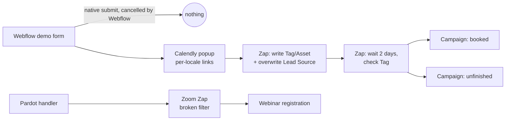
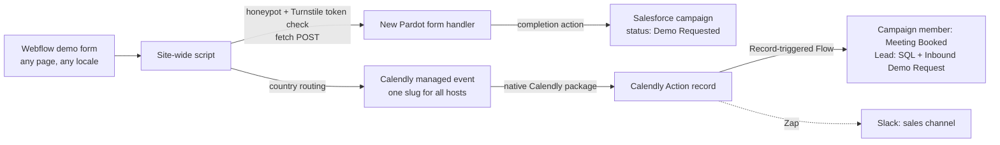

# Demo Funnel Rebuild: Webflow → Pardot → Calendly → Salesforce

A case study of rebuilding the website demo-request funnel of a B2B SaaS company that runs on Webflow, Salesforce Marketing Cloud Account Engagement (Pardot), Calendly and Salesforce.

For more than a month, **no demo request from the website reached the marketing automation platform**. Booking data reached Salesforce only through a chain of Zaps that guessed, with delays, whether someone had booked. The rebuild replaced that chain with one site-wide script, one form handler, one shared Calendly event and one Salesforce Flow.

> All company-specific values (URLs, account IDs, record IDs, people, usernames) are replaced with placeholders.

---

## The problem

| Symptom | Impact |
|---|---|
| The Pardot form handler for demo requests had not received a submission in weeks | Every demo request that didn't book a meeting was lost. No follow-up, no reminder |
| "Unfinished demo request" campaign stopped growing on the same day | Sales had no list of people who asked for a demo but never booked |
| Demo prospects got a **webinar registration email** | Wrong communication and polluted webinar lists |
| "Demo booked" was inferred from `Tag` / `Asset` fields written by a Zap | Those fields are overwritten by every other conversion (guides, webinars), so the signal was unreliable |
| Country routing to Calendly differed per locale | The same visitor could land with a different rep depending on the language of the page |

## Root causes

Each one was confirmed with a browser or data test before anything was changed. Details are in [`docs/root-cause-analysis.md`](docs/root-cause-analysis.md).

1. **Webflow intercepted the form.** The form used Webflow's newer form model ("Send to: Webflow", Cloudflare Turnstile). Webflow's script cancelled the native submit (`event.defaultPrevented === true`), so the old script's "post into a hidden iframe" approach never sent anything (`iframe = about:blank`).
2. **The script targeted the wrong element.** On the primary locale, the ID it looked up sat on the Form Block wrapper, not on the `<form>`.
3. **Coverage gap.** A crawl of the 1,310 sitemap URLs showed the demo form on **212 pages**, but the script only on **30**.
4. **A broken Zap filter.** A Zoom-webinar Zap compared the form handler *name* with **"(Date/time) Equals"**. Neither side parses as a date, so "empty = empty" was true for every form, and every submitter was registered for webinars.
5. **Fragmented, overwritable state.** Several Zaps wrote `Tag`, `Asset` and `Lead Source`, waited 48 hours, and moved records between campaigns based on those fields.

## Architecture

### Before



### After



## What was built

| Area | Change | Docs |
|---|---|---|
| Webflow | One site-wide script that finds every demo form by its email field, routes to Calendly by country (local spellings included) and POSTs to Pardot with `fetch` after honeypot and Turnstile-token checks | [`webflow/`](webflow/) |
| Pardot | New, minimal form handler: email and country only, a single completion action (add to campaign as *Demo Requested*), no autoresponders | [`pardot/`](pardot/) |
| Calendly | One **managed event** assigned to every demo host. The slug is locked (the integration key); hosts can translate the title, set the location and translate the questions | [`calendly/`](calendly/) |
| Salesforce | Record-triggered Flow on the Calendly package's `Calendly Action` object: matches the booking to the campaign member, sets *Meeting Booked*, sets the lead to SQL, flags *Inbound Demo Request* | [`salesforce/`](salesforce/) |
| Zapier | Fixed the webinar Zap filter. New Slack notification Zap built on the Salesforce record (not on Calendly), filtered by slug | [`zapier/`](zapier/) |

## Key design decisions

The full reasoning is in [`docs/decisions.md`](docs/decisions.md).

- **The event-type slug is the source of truth.** It's locked in the managed event and invisible to invitees, unlike event names, which hosts translate.
- **No "derived" state fields.** The booking is read directly from the Calendly integration's own records, and processed in Salesforce at the moment it's created.
- **Processing lives in Salesforce, not in Zapier.** Flows run synchronously and don't consume API calls. Zapier is used only for notifications.
- **Two triggers cover both orderings.** Booking first or form first: whichever event comes second performs the update. No polling, no waiting periods.
- **Email changes are handled.** The form email is passed to Calendly as `utm_content`, and the Flow prefers it over the email the invitee typed in Calendly.

## Results

- Demo requests reach the marketing automation platform again, on every page and locale (212 pages instead of 30).
- One shared Calendly link per host. Routing is identical across all locales and configured in one place.
- Website demo bookings update the campaign status and lead status the moment they're created.
- Webinar registrations triggered by demo forms stopped.
- Booking state no longer depends on fields that other conversions overwrite.

## Repository layout

```
webflow/      Site-wide demo form script + install notes
pardot/       Form handler configuration
calendly/     Managed event setup and routing table
salesforce/   Flow logic (step by step) + data model notes
zapier/       Slack notification Zap + webinar Zap fix
docs/         Root cause analysis, decisions, roadmap
```

## Roadmap

See [`docs/roadmap.md`](docs/roadmap.md): adding non-members who book directly, the 48-hour reminder email, server-side bot protection, and retiring the old Zaps.

---

Author: Ayşe Altınsoy · Marketing operations / RevOps
