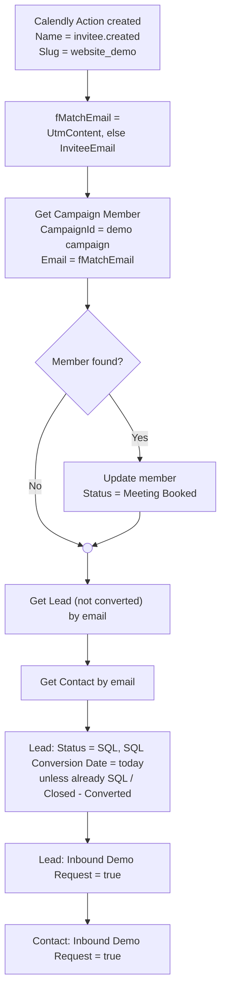

# Salesforce: "Demo Booking" record-triggered Flow

## Data source

The native Calendly–Salesforce package writes one **`Calendly Action`** (`Calendly__CalendlyAction__c`) record per event. Calendly never updates these records, so every booking is a new record.

Fields used:

| Field | Use |
|---|---|
| `Name` | `invitee.created` = booking · `invitee.canceled` = cancellation |
| `Calendly__EventTypeSlug__c` | Identifies the website demo (`website_demo`) |
| `Calendly__InviteeEmail__c` | Email the invitee typed in Calendly |
| `Calendly__UtmContent__c` | Email from the website form, passed by the script |
| `Calendly__UtmTerm__c` | Country from the website form, passed by the script |
| `Calendly__EventPrimaryPublisherEmail__c` / `…Name__c` | Host |
| `Calendly__CustomResponse1__c` / `2__c` | Organization name / message |

The object has **no lookup to Lead or Contact**. Matching is done by email.

## Flow logic



## Build steps

**Start**
- Object: **Calendly Action**, trigger: **A record is created**
- Entry conditions (AND): `Calendly Action Name` Equals `invitee.created`; `Event Type Slug` Equals `website_demo`
- Optimize for: Actions and Related Records

**Formula resource `fMatchEmail` (Text)**
```
IF(ISBLANK({!$Record.Calendly__UtmContent__c}),
   {!$Record.Calendly__InviteeEmail__c},
   {!$Record.Calendly__UtmContent__c})
```

**Get Records: `Get Campaign Member`**: Campaign Member where `CampaignId` = demo campaign ID AND `Email` = `{!fMatchEmail}`; sort Created Date desc; first record only.

**Decision: `Is member`**: `Get Campaign Member > Campaign Member ID` Is Null = False.

**Yes branch → Update Records `Set Booked Meeting`**: Campaign Member where `Id` = found member ID; `Status` ← `Meeting Booked`.

**After both branches merge:**
- **Get Records `Get Lead`**: Lead where `Email` = `fMatchEmail` AND `IsConverted` = False; Last Modified desc; first record.
- **Get Records `Get Contact`**: Contact where `Email` = `fMatchEmail`; Last Modified desc; first record.
- **Update `Set Lead SQL`**: Lead where `Id` = Get Lead ID, not converted, Status ≠ `Sales Qualified (SQL)`, Status ≠ `Closed - Converted` → Status ← `Sales Qualified (SQL)`, `SQL Conversion Date` ← `$Flow.CurrentDate`.
- **Update `Set Inbound Demo Lead`**: Lead where `Id` = Get Lead ID, not converted → `Inbound Demo Request` ← True.
- **Update `Set Inbound Demo Contact`**: Contact where `Id` = Get Contact ID → `Inbound Demo Request` ← True.

When a member is a Contact, the Lead updates find no record and do nothing. That's intended: Contacts have no Lead Status.

## Why "created" only

Calendly never updates an existing Calendly Action record. Bookings, cancellations and reschedules each create new records. *Created or updated* would add nothing and could re-run the Flow on manual edits.

## Testing

1. Submit the demo form (you become a campaign member, *Demo Requested*).
2. Book a slot on any host's `website_demo` link with the same email.
3. Flow Builder → **Debug** → select the new Calendly Action → *Run as if the record is created* (rollback mode on).
4. Expect: member found → *Meeting Booked*; lead → SQL; *Inbound Demo Request* checked.

## Second Flow (planned)

A record-triggered Flow on **Campaign Member created** covers the reverse order (booking first, form later): it looks back 30 days for a `website_demo` Calendly Action with a matching email and applies the same updates. See [`../docs/roadmap.md`](../docs/roadmap.md).
